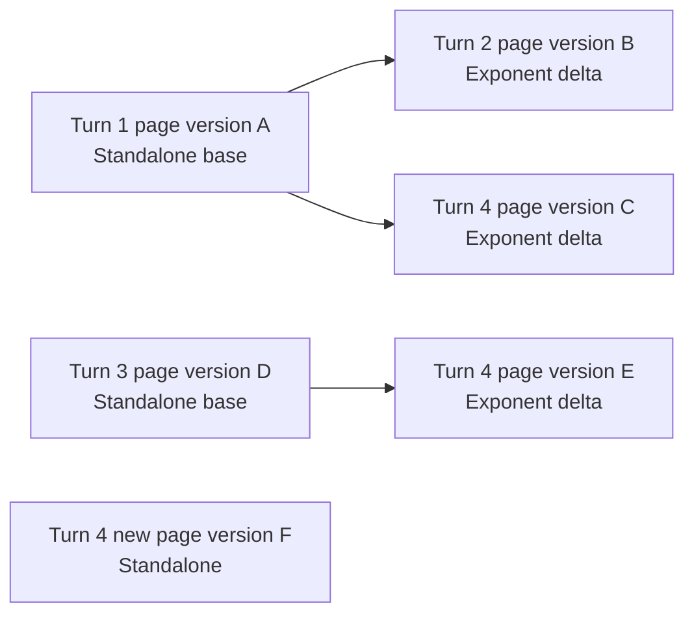

# Exact KV differential storage tree

EvidenceStore can keep a new version of a KV page as a small lossless delta against an earlier version. The prefill worker's host cache stores the compact frame and reconstructs the original BF16 page when the model needs it. The working offline prototype uses **one-hop exponent deltas with forward base pinning**. In the five-turn test it served **213 of 213** page loads at **128 MiB** of modeled host-cache capacity. The same standalone codec served **207 of 213** at that budget and reached 213 at **132 MiB** on the tested grid. [CLAPNQ comparison][comparison]

The live capture used raw KV in LMCache. The offline prototype verifies byte-exact reconstruction and tests how much KV stays resident with different encodings. A live integration can measure process RAM, GPU staging, prefill fallback work, and request latency with the same prompts and cache budget. [Capture and replay runbook][runbook]

## Where it fits in serving

1. P runs prefill or Blend and supplies a complete, cacheable KV page to LMCache. A page in this workload is **16 tokens across 36 layers**, with K and V, for **2.25 MiB** of BF16 bytes.
2. The host cache stores an independent frame or a delta plus a base version reference. Keeping that representation in host RAM saves resident memory. Persisting those same frames to disk can also save disk space.
3. On a hit, the cache reconstructs the full target KV page and supplies it for ordinary H2D staging and Blend. The serving application still sends the usual prompts and receives the usual responses. vLLM attention consumes the exact reconstructed BF16 values.
4. P can hand the final KV to D through the existing NIXL path. A receiver-aware delta handoff can save additional bytes when D has a compatible base for the final target. That transfer has its own base lookup, read, and reconstruction costs. [Page layout and placement][design] · [P to D handoff measurements][handoff]

## Page versions and bases

Each page version identifies an immutable result. A **base**, also called an **anchor**, is an independently restorable page that supplies bytes to one or more deltas. Different target pages can choose different compatible bases. The arrows below mean that the left page supplies an exponent stream to the right page.



The prototype restores a dependent through at most one independently encoded base. The conversation history identifies which KV versions the request needs. The storage graph identifies how to restore each of those versions. A base can support reconstruction even when its own page is outside the requested attention sequence.

The replay considers earlier stores from different requests on the same worker and process, with compatible dtype, native format, and page geometry. It shortlists recent matches by logical page identity, absolute token offset, and within-object offset, plus base versions identified by the trace. At store time, page identity and alignment help locate useful candidates. Actual tensor bytes and byte-exact reconstruction determine which representation can be used. A live store should scope version IDs and compatibility to the loaded model and cache layout. [Candidate selection][candidate-code]

## Store, restore, and eviction

Split every BF16 value into its **exponent** and its **sign and fraction** fields using a reversible bit rearrangement. A standalone frame compresses both target streams separately. The exponent-only delta compresses the XOR of the target and base exponents and stores the target sign and fraction stream independently. The prototype uses Zstd level 3 for both streams.

```text
Standalone = compressed target exponent + compressed target sign and fraction
Delta      = base version ID + compressed (target exponent XOR base exponent)
             + compressed target sign and fraction

Restore target exponent = base exponent XOR decoded exponent delta
Restore complete page   = join target exponent with target sign and fraction
```

### Build the storage graph one page at a time

1. **Identify the exact target.** P produces the cacheable prompt page, or D produces a committed answer page. Record its version ID, model and layout, token span and prefix identity, and digest of the final BF16 bytes. If that version is already resident, refresh its recency and reuse it. An exact match to another compatible stored page can use a reference to those bytes.
2. **Find candidate bases.** Look up compatible earlier versions using the logical page, token alignment, or traced base identity. The working one-hop policy considers resident, independently encoded bases. Each target chooses its own base. The first page, or any page with no suitable base, has an independent representation and can become a root for later writes.
3. **Encode and compare.** Encode the standalone target and build a patch for each shortlisted base. For an exponent patch, XOR the two exponent streams and compress the result alongside the target's sign and fraction stream. Decode each proposed patch against its exact base and check the resulting bytes against the target. The tested forward policy tries the smallest eligible delta first. Its complete frame must be at least **5% smaller** than standalone, and the proposed resident set must fit the cache budget. The 5% threshold is a test setting.
4. **Commit the frame and its dependency.** For a delta, store the target ID, frame, codec and base version ID together. Pin the base before publishing the target for reading. A standalone write publishes the same target ID with a self-contained frame. In a live backend, recheck the base and capacity at commit time. If the base disappeared, try another feasible representation or use a standalone frame. When no representation fits, the cache can decline the admission.
5. **Publish IDs for later readers.** The target version names the exact page bytes, and the stored frame explains how to obtain them. P or D can reuse a matching materialized page, fetch the committed representation, or receive a direct delta against a compatible base it already holds. A later update stores a new target version while earlier versions stay available for active requests or dependencies. [Candidate encoding and verification](../scripts/vllm_pd_legacy_cache_replay.py#L93-L120) · [Admission and pinning policy][replay-code]

For example, suppose a **1.60 MiB** standalone base `B` is already retained. A new page `T1` would occupy **1.62 MiB** independently or **1.36 MiB** as a delta against `B`. Storing the delta adds **0.26 MiB less** and creates the edge `B → T1`. A later page `T2` can choose `B`, another standalone base, or its own independent frame. If keeping `B` were necessary solely for `T1`, the two frames would occupy **2.96 MiB** together, so the **1.62 MiB** standalone target would be smaller under that storage comparison.

### Restore and reclaim pages

- **Read.** With a decoded base exponent ready, read the target frame and reconstruct from it. With an encoded base, read and decode only its exponent stream. Join the recovered exponent and target sign and fraction to form the full page. The codec tests compared every reconstructed page against the captured bytes, and replay audits checked digests on hits at the tested full-hit budgets. A live backend can treat an unavailable or incompatible base as a miss and follow its ordinary recovery path.
- **Keep dependencies valid.** Forward pinning keeps each referenced base alive until its last dependent is released. Normal least-recently-used eviction, or LRU, can free entries that have no dependents. A repack policy can instead materialize surviving dependents into self-contained frames before releasing their base. An online store must commit the frame and its reference together and keep the base available to in-flight readers through reconstruction.
- **Account for resources.** The frame includes compressed-stream lengths and codec framing. The replay charges **32 B for the version ID** and another **32 B for a base reference**. A live memory measurement also needs the actual cache index, allocator overhead, reconstruction scratch, decoded anchors, and repack buffers. Charge each retained base once at the size and lifetime required by its dependents. [Replay and eviction logic][replay-code] · [Frame accounting][entry-code]

```text
Net bytes saved = standalone target bytes
                  − delta frame bytes including metadata
                  − additional bytes to retain or decode-cache its base
```

## When the application benefits

| Operation | Benefit and the condition that enables it |
| --- | --- |
| **Write a new version** | Commit a smaller target frame when an earlier base is already useful to the cache. The prototype examines the full new KV page on the host to decide and encode the exact delta. Fewer committed bytes can reduce writes into the encoded cache or a persistent tier. |
| **Read a page** | A decoded exponent base lets P read the smaller target frame and reuse the base in memory. An encoded base adds a partial read and a decode. The model receives the full reconstructed page in either case. |
| **Update history or evidence** | Keep new and earlier versions available without storing each as a complete independent frame. A later request can select its exact version. When available during staging, one decoded anchor can supply several dependent restores. |
| **Serve later turns** | Smaller resident frames can retain more useful KV across turns. More local hits can avoid slower-tier fetches or prefill recomputation depending on the live miss path. More usable capacity may also fit longer histories or more concurrent conversations. |
| **Hand off KV to D** | If D has the compatible base, send the delta and the required new data, then reconstruct at D. Charge any fetch or prefetch of the base to its tier along with transfer and reconstruction time. |

### Measured write and read costs

On the same **nine selected base–target pairs**, raw target pages totaled **20.25 MiB**. Standalone Zstd field frames totaled **14.57 MiB**, a **28.1%** saving versus raw. The exponent deltas totaled **12.27 MiB**, a **39.4%** saving versus raw and **15.8%** fewer target bytes than the matched standalone encoding. That incremental saving assumes the bases are retained. With the decoded exponents already ready, modeled input falls from 14.57 MiB to 12.27 MiB for those loads. Reading all nine compressed base exponents adds **4.44 MiB**, bringing delta input to **16.72 MiB**. [Matched byte and timing details][comparison]

| Zstd field format | Median CPU encode per page | Median CPU restore per page |
| --- | ---: | ---: |
| Standalone | 6.91 ms | 1.81 ms |
| Exponent delta with decoded base exponent ready | 6.97 ms | **1.43 ms** |
| Exponent delta with compressed base exponent | 8.56 ms | 3.02 ms |

The timing intervals use the known base and host-memory buffers. Writes include field transformation and compression. Reads include the required decompression and assembly. Candidate lookup, storage I/O, SHA verification, H2D, and request latency have separate costs. Warm reads assume a prior load or staging batch has already decoded the base exponent. Keeping it decoded longer consumes additional cache memory. In the separate whole-page packed test, making all nine bases raw would add **6.19 MiB**, while their nine deltas save **3.45 MiB** on target frames. [Restore and base-residency timings][comparison]

### Measured cache coverage and transfer

The five-turn conversation had **105 stores and 213 load events**. It used the docs-first `previous-turn-first` prompt policy on 1B/3D. In the **128 MiB** replay, standalone LRU had **207 hits and six misses**. Forward pinning with the exponent-only option had **213 hits, zero misses, and zero rewrites**. Smaller frames elsewhere in the cache let it keep all six requested pages as standalone frames. This prevented an eviction cascade in turn 5. Both policies consumed the same **343.7 MiB** of encoded target reads at their respective first full-hit budgets. [Eviction sequence and capacity sweep][comparison] · [Pinned five-turn capture][five-turn]

Across the wider **six conversations and 40 turns**, independent gzip frames from the archive saved **18.70%** versus raw across **2,888 pages**. The traced exact-row patches saved **0.15%** of raw bytes under their observed base assumptions. These figures show why a strong standalone baseline matters. The six-conversation experiment measured native P → D NIXL payload of **9.71 GiB** for the natural turns. The separate earlier changed-row handoff sent **35.18% fewer NIXL bytes** over **156 measured requests**, with **98.59%** decoder base coverage. That result describes the earlier transport configuration. [Six-conversation index][campaign] · [Campaign results][comparison] · [Earlier handoff][handoff]

## Encoding and cache policies we have tested

| Option | What we learned |
| --- | --- |
| **Raw pages and independent compression** | Raw is the reference for byte identity and the serving fallback. Gzip, shuffled layouts, and independent BF16 field compression provide self-contained baselines. The campaign-wide 18.70% figure uses actual per-page gzip file sizes. |
| **Exact references and row replacement** | A byte-identical region can refer to its source directly. A row patch stores replacement rows and a map for exact source rows. Across six conversations, all 556 selected raw row patches were larger than their standalone gzip frames. This makes whole-row savings a poor predictor of bit-level savings on this trace. |
| **Slot remapping, layer-local selection, and two bases** | In job 30547, one layer-0 target matched 18 of 32 K/V rows using two bases versus 12 using the best single base. That layer's representation fell from 41,082 B to 28,864 B, and the full target reconstructed exactly. Reserving source layers across the capture made the greedy two-base approach save less overall than one base. |
| **Bit-level residuals and whole-page XOR** | The earlier page study measured enough similarity on changed pages for compressed residuals. Its best differential graph saved about 1.9% beyond the best independent encoding across 91 pages. XOR against the preceding layer expanded size by 4.4% in the earlier layer test. Base choice and storage layout matter. |
| **Compact row references and exact exponent packing** | Sparse and bitmap row selectors reduce reference metadata. Compact row selectors alone kept the earlier full-hit threshold unchanged. Packing frequent BF16 exponents into 4-bit codes with exact escapes reduced the earlier 157-load full-hit budget from 102.875 to 98.1875 MiB. |
| **Warm base reuse and fused native assembly** | Using the same stored frames, decoding fields and assembling the XOR result in a native pass reduced median CPU restore with an encoded base from 28.75 to 7.72 ms on the nine pairs. The matched native standalone decode took 3.47 ms. |
| **Whole-page Zstd and exponent-only Zstd** | Whole-page Zstd decoded in 1.89 ms standalone and 4.15 ms with an encoded base on the matched sample. Exponent-only with an encoded base took 3.02 ms because it needed only the base exponent stream. With that exponent decoded, restore took 1.43 ms. |
| **Forward pinned, demand-selected, and repack on eviction** | Forward pinning uses a smaller viable delta against an earlier resident base. Demand selection uses past load counts and can reverse an edge to keep a newer version independent. Repacking materializes surviving children before evicting the base. In the packed replay at 124 MiB, all three gave 213 hits. Forward pinning had zero rewrites, demand selection wrote 10.61 MiB, and repacking wrote 14.06 MiB. Those measurements use the packed codec. |

The job 30547 data characterizes the early row, layer, and bit-level experiments. The job 30568 reference fixes the later timing, memory budget, and cache-hit comparisons. [Earlier raw capture and analysis][design] · [Packed selector codec][packed-rows] · [Exact exponent palette][packed-exponents] · [Recent measurements][comparison]

## Comparison with TokenDance

Both designs store references to a base and encode differences. TokenDance focuses on sibling KV caches that share content within a multi-agent round. EvidenceStore's working replay focuses on immutable page versions that can be reused across conversation turns. [TokenDance, Bian et al., arXiv:2604.03143v1][tokendance] · [EvidenceStore replay][comparison]

| Dimension | TokenDance | EvidenceStore |
| --- | --- | --- |
| **How reuse is found** | In synchronized All-Gather rounds, agents receive common outputs. The KV Collector batches RoPE and repair-position selection across compatible requests. | The storage prototype takes finished pages, then looks for earlier compatible versions by page identity, token alignment, and traced base identity. Blend handles any upstream repair. |
| **How the base is chosen** | Each cache family keeps one dense **Master**. The reuse plan chooses it. A token-similarity heuristic can select a cached Master when there is no plan. | Each target page can choose its own resident standalone anchor. Forward pinning checks the encoded saving and cache budget, then retains the anchor while its dependents live. |
| **What a delta contains** | A **Mirror** stores block indices and K/V corrections for changed blocks. | The exponent-only format stores a lossless BF16 exponent residual and the target's compressed sign and fraction. This can capture similarities within rows whose complete bytes changed. |
| **How restore works** | The GPU connector applies the sparse corrections and recovers positions during layerwise staging into paged KV. | The offline prototype reconstructs and verifies exact page bytes on the host. A live P/D path would use receiver residency to choose direct reuse, a delta handoff, or a fetch from shared storage. |

The paper details collective reuse in §4.2 and storage and restore in §§4.3–5. Its authors describe recovery as equivalent to the underlying per-request CacheBlend method. EvidenceStore checks byte equality against the page supplied to the encoder. Those checks establish correctness relative to the respective KV inputs. [TokenDance collective reuse][tokendance-reuse] · [TokenDance storage and restore][tokendance-storage] · [TokenDance fidelity evaluation][tokendance-fidelity] · [EvidenceStore codec checks][comparison]

TokenDance reports a **17.5× dense-to-Mirror storage ratio** for Qwen2.5-14B in a GenerativeAgents round. Its family-level capacity calculation charges the shared Master once. EvidenceStore measured **15.8% incremental target-frame savings versus standalone Zstd** on nine matched pages and **213 versus 207 local hits** at 128 MiB in one five-turn replay. The numbers use different workloads, baselines, and cache scopes. [TokenDance §6.4][tokendance-results] · [EvidenceStore measurements][comparison]

A matched storage experiment would hold the final KV pages, available bases, and cache budget fixed. Compare standalone compression, TokenDance-style changed-block storage, and exponent-only deltas. Charge the shared base once and measure warm and cold read bytes, exact restore time, and hit coverage. This would show when whole-block sharing pays off and when coding the bits inside changed blocks adds value.

## Concepts to test against the working policy

| Concept | Test and decision criterion |
| --- | --- |
| **Choose a representation per region** | Test independent K and V tiles, selected exponent or fraction streams, exact row references, and conditioned lossless encodings such as modular residuals or dictionaries. Admit a region delta only after charging headers and reading every region needed for a byte-exact restore. |
| **Find better bases** | Compare candidates based on conversation version, token alignment, chunk identity, and observed popularity. Compare a one-base target with a two-base target while charging both anchors across eviction and measuring cold reads. |
| **Reuse or predecode a hot exponent** | Group dependent restores that need the same anchor or predecode when the next request supplies a reliable signal. Track actual fan-out, scratch high-water mark, anchor reads, and unused prefetches. Compare against leaving the same bytes available to retain more compressed pages. |
| **Choose with latency as well as size** | Use prior demand to keep frequently loaded targets independent or close to a ready base. Compare that policy with the 5% size-only rule. Measure candidate-search CPU, avoided misses, and the timing of both hot and cold restores at an equal byte budget. |
| **Bounded delta chains and checkpoints** | Compare the working one-hop graph with a two-hop cap, independent checkpoints, and direct deltas to popular checkpoints. Include rewrite costs from shortening a chain and count every cold dependency read. Check recovery after eviction and compare p95 restore, committed bytes, and hit coverage. A manifest checkpoint can accelerate version lookup while a materialized checkpoint supplies independent bytes. |
| **Locality across workers and tiers** | Start with a fixed P budget. Then test 2B/2D with repeated conversations or shared anchors. Compare keeping data on its original worker, moving a compact frame plus dependencies, and reconstructing from another tier. Account for the actual transferred bytes and the cost of an unavailable base. |
| **Receiver-aware P → D** | Inventory the exact base versions D has. Compare a full handoff with changed rows and an exact compressed field delta. Include base-prefetch bytes, manifest bytes, patch application, and the full fallback when coverage is insufficient. |

### Reuse materialized pages on D

D can keep the exact BF16 page it reconstructed from either a direct delta or the shared storage graph. The retained page is a fast copy keyed by its immutable version. The graph holds the encoded form and its dependencies so the page can be restored after the fast copy is evicted.

| D's state for the requested version | Handoff path |
| --- | --- |
| Exact target ready in D's GPU cache | Pass the target ID and reuse the existing page. No KV payload or reconstruction is needed. |
| Exact target decoded in D's host cache | Stage the complete page to D's GPU and reuse the existing decoded bytes. |
| Target missing, compatible base ready on D | Send a delta directly from P or let D pull its frame from shared storage. Reconstruct the target and keep it in D's cache. |
| Target and usable base missing on D | Let D pull the target's required frames and base fields from the graph, or use a standalone target when cheaper. |

For example, after D reconstructs `T1` from `B` once, any request for the exact `T1` can reuse it while it remains resident. If the next turn needs a new `T2`, materialized `T1` can serve as a base for a direct handoff. To store `T2` in the one-hop graph, encode it against a standalone anchor or promote `T1` to independent storage first. Pin pages during active decode and keep the backing dependencies available for reconstruction after eviction. Compare exact-target hits, direct delta bytes, graph fetch bytes, reconstruction counts, and handoff latency in the live test.

### Reuse the previous answer's KV from D on P

The same storage codec can hold KV created during decode. D would export the answer pages and the exact generated token IDs to a cache that P can query. The cache can retain a new answer page as an independent frame or as a delta when a compatible base makes it smaller. For each exported page, publish the model and layout, token prefix identity, positions, and the last token whose KV was actually written. On the next turn, P can restore compatible answer KV and prefill the uncovered suffix. [Legacy connector setup](../scripts/vllm_pd_cluster.py#L199-L215)

Exact reuse requires the next request to carry the actual generated history with the same causal prefix, token positions, and compatible KV state over the reused range. In the docs-first format, changed or reordered evidence before the old answer can change its KV. Changing how the old question and answer are formatted can also change the token prefix. D's saved tensor can still be evaluated as a compression base for a newly computed target. In that case the delta saves storage or movement after P computes the target.

Job 30568 attached LMCache to P and used D as a NIXL consumer. Its next turns used fixed dataset reference history. A D-to-P test needs a separate replay that appends the actual generated token sequence. Begin with an append-only control and then test changed evidence. Compare the normal P recompute path, shared raw answer KV exported from D, and D export with independent or differential encoding at the same cache budget. Record D's export work, bytes on both restore hops, P's matched and recomputed token ranges, and next-turn time to first token. [Reference-history replay](../scripts/vllm_pd_replay.py#L236-L241) · [Append-only test case](slide-4-pd-measurement-plan.md#controlled-and-natural-replay)

## How to compare the next run

Use the pinned job 30568 captures for byte-exact CPU checks, then hold the same prompts, model, worker placement, cache budget, and workload order fixed in a gated 1B/3D test. The reference capture used a fresh cache per conversation and docs-first `previous-turn-first` throughout. A docs-first versus history-first comparison should keep the storage policy fixed while changing prompt layout. [Prompt policy evidence][prompt-policy] · [Campaign runbook][runbook]

The checked-in packed replay can be run from a results checkout with the requested packets available. Verify each packet before starting. The exponent-only reference uses the field specification above and the nine matched CPU timings and five-turn cache replay in the comparison report.

```bash
capture=reports/smoke/mtrag-multi-turn-repeat-legacy-full-blend-30568-20261123T021621Z
python3 -B scripts/vllm_pd_legacy_blend_archive.py --verify "$capture"
python3 -B scripts/vllm_pd_legacy_packed_replay.py "$capture/1p3d/blend" \
  --capacity-mib 96 112 120 124 128 132 136 160 192
```

- **Exactness and lifecycle.** Check every target's digest. Exercise new page admission, updates, source eviction, concurrent readers, and restore after a cache miss. Count base and target hits, rewrites, rejections, and fallbacks.
- **Memory and movement.** Track committed frames, dependencies, decoded anchors, allocator and scratch high-water, cold and warm host reads, GPU staging, and native P → D bytes. Include boundary fragments when evaluating actual memory capacity.
- **Time and application behavior.** Time candidate selection, encoding, dependency lookup and reads, reconstruction, and staging. Report p50 and p95 alongside measured fallback prefill work, request time to first token, and throughput. Compare trace-on and trace-off timings at the same load.

[comparison]: datasets/mtrag-clapnq-kv-comparison-30568.md
[design]: kv-differential-storage.md
[prompt-policy]: datasets/mtrag.md#three-prompt-policies-on-one-blend-worker
[runbook]: vllm-legacy-full-blend-runbook.md#capture-the-six-complete-conversations-in-one-allocation
[handoff]: vllm-legacy-full-blend-tracing.md#smoke-check-on-archived-gpu-evidence
[campaign]: https://github.com/Kibnelson/evidence_store_1/blob/a7b976f/reports/campaigns/clapnq-30568.json
[five-turn]: https://github.com/Kibnelson/evidence_store_1/tree/a7b976f/reports/smoke/mtrag-multi-turn-repeat-legacy-full-blend-30568-20261123T021621Z/1p3d/blend
[entry-code]: ../scripts/vllm_pd_legacy_cache_replay.py#L19-L40
[candidate-code]: ../scripts/vllm_pd_legacy_cache_replay.py#L58-L73
[replay-code]: ../scripts/vllm_pd_legacy_packed_replay.py
[packed-rows]: ../scripts/vllm_pd_legacy_packed_codec.py
[packed-exponents]: ../scripts/vllm_pd_legacy_packed_independent.py
[tokendance]: https://arxiv.org/abs/2604.03143v1
[tokendance-reuse]: https://arxiv.org/pdf/2604.03143v1#page=5
[tokendance-storage]: https://arxiv.org/pdf/2604.03143v1#page=6
[tokendance-fidelity]: https://arxiv.org/pdf/2604.03143v1#page=11
[tokendance-results]: https://arxiv.org/pdf/2604.03143v1#page=10
